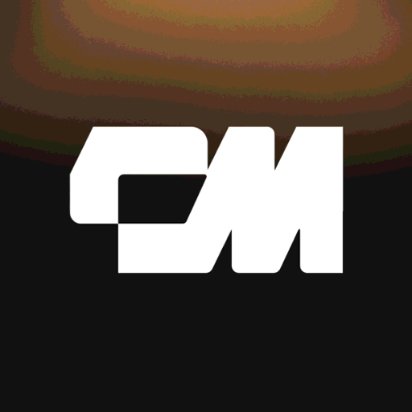

# ConnectMachine power for Kiro

Your professional network in Kiro. Find people by how you remember them, save contacts from the conversation, and write follow-ups with the context of where you met.

This power bundles the hosted [ConnectMachine MCP server](https://github.com/connectmachine/mcp-server) (`https://mcp.connectmachine.ai/mcp`, Streamable HTTP) with skills that show the agent how to use it. There's nothing to install or run locally.

## Install

In Kiro, open the **Powers** panel, choose **Add Custom Power**, then **Import power from GitHub** and enter `https://github.com/connectmachine/kiro-power`.

The first time the agent uses ConnectMachine, Kiro opens a browser so you can sign in with your ConnectMachine account (OAuth). Any account works, including free ones. No API keys needed.

## What's included

| Component | What it does |
|---|---|
| **ConnectMachine MCP server** | Contacts, networks, events, digital business cards and notifications |
| **`connectmachine` skill** | Search by what you remember, check before updating, and attach where you met |
| **`save-contact` skill** | Save someone from a description, without creating duplicates |
| **`follow-up` skill** | Draft short follow-ups that mention where you met. Nothing is sent |

Tools that change or delete data are annotated as such, so Kiro asks before running them.

## Try asking

- "Which founders do I know in fintech?"
- "I met Sara Khan from Northstar Pay at WebSummit, save her."
- "Draft follow-ups to the people I met last week."
- "Put John William in my Investors network."

## Privacy and support

- Privacy Policy: https://connectmachine.ai/legal/privacy
- Terms of Service: https://www.connectmachine.ai/legal/terms-of-service
- Docs: https://www.connectmachine.ai/docs/mcp/
- Support: [open an issue](https://github.com/connectmachine/kiro-power/issues) or email hi@connectmachine.ai

## License

MIT
